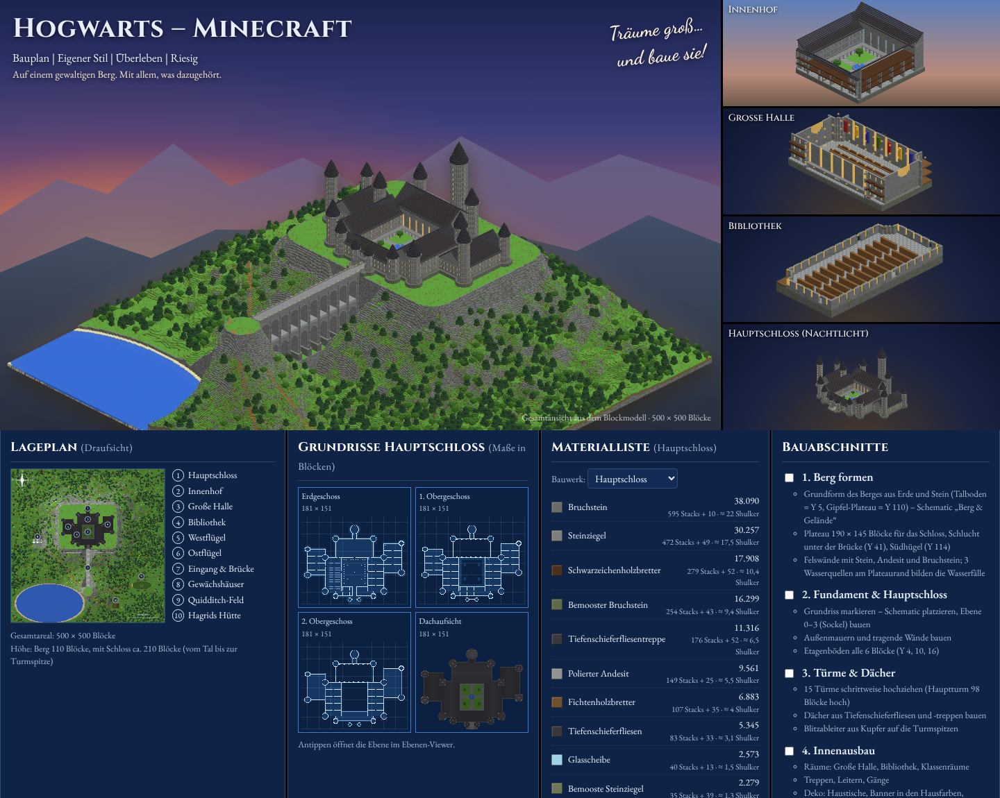

# Hogwarts – Minecraft Bauplan



Eine Website mit einer detaillierten Bauanleitung für ein riesiges Hogwarts-Schloss in Minecraft (Überlebensmodus), auf einem gewaltigen Berg – mit allem, was dazugehört.

**Inhalt der Seite (`index.html`)**

- **Gesamtansicht** – Berg, Schloss, Viadukt, See, Wälder, Quidditch-Feld und Hagrids Hütte, gerendert aus dem echten Blockmodell
- **Detailansichten** – Innenhof, Große Halle, Bibliothek, Hauptschloss
- **Lageplan** – Draufsicht auf das 500 × 500 Blöcke große Areal mit den 10 wichtigsten Orten
- **Grundrisse** – Erdgeschoss, 1. und 2. Obergeschoss, Dachaufsicht (181 × 151 Blöcke)
- **Materialliste** – exakt gezählt, mit Stacks und Shulkerkisten, pro Bauwerk oder für alles
- **Bauabschnitte** – 7 Schritte zum Abhaken (der Fortschritt wird im Browser gespeichert)
- **Ebenen-Viewer** – wie der Ebenen-Modus von Litematica: Ebene für Ebene, mit Koordinaten jedes Blocks und 3D-Vorschau
- **3D-Ansicht (`3d.html`)** – frei durch die Welt fliegen, Bau im Zeitraffer, Blockname unter dem Fadenkreuz
- **Litematica-Downloads** – alle Bauwerke als `.litematic`

## Bauwerke

| Bauwerk | Größe (X × Y × Z) | Lage im Areal (X / Y / Z) | Datei |
|---|---|---|---|
| Berg & Gelände | 500 × 138 × 500 | 0 / 0 / 0 | `schematics/hogwarts-berg.litematic` |
| ↳ nur Gelände (zuerst bauen) | 500 × 138 × 500 | 0 / 0 / 0 | `schematics/hogwarts-berg-gelaende.litematic` |
| ↳ nur Wald (ca. 1.700 selbstgebaute Bäume, Blumen) | 500 × 138 × 500 | 0 / 0 / 0 | `schematics/hogwarts-berg-wald.litematic` |
| Hauptschloss | 181 × 100 × 151 | 160 / 111 / 110 | `schematics/hogwarts-hauptschloss.litematic` |
| Viadukt (Brücke) | 13 × 76 × 123 | 244 / 42 / 261 | `schematics/hogwarts-bruecke.litematic` |
| Brückenkopf & Steinkreis | 33 × 24 × 33 | 234 / 115 / 384 | `schematics/hogwarts-brueckenkopf.litematic` |
| Hagrids Hütte | 23 × 22 × 17 | 330 / 6 / 438 | `schematics/hogwarts-hagrids-huette.litematic` |
| Gewächshäuser | 31 × 10 × 15 | 70 / 6 / 230 | `schematics/hogwarts-gewaechshaeuser.litematic` |
| Quidditch-Feld | 71 × 20 × 39 | 390 / 6 / 360 | `schematics/hogwarts-quidditch.litematic` |
| **Gesamtprojekt** | 500 × 211 × 500 | alle 7 als Regionen | `schematics/hogwarts-gesamt.litematic` |

Gebaut wird in **Minecraft 26.3** (Java). Die Schematics nutzen das Datenformat von 1.20.1; Litematica konvertiert sie beim Laden automatisch auf die eigene Version.
Lege das Areal so, dass Y 0 ungefähr auf Höhe 60 liegt – dann endet die höchste Turmspitze bei ca. Y 270 (Bauhöhengrenze 320).

## Ansehen

Einfach `index.html` im Browser öffnen, oder einen lokalen Server starten:

```bash
python3 -m http.server 8000
# dann http://localhost:8000 öffnen
```

Über **GitHub Pages** (Einstellungen → Pages → Branch wählen) lässt sich die Seite direkt veröffentlichen.

## Selbst anpassen

Alles wird aus einem einzigen Blockmodell erzeugt: `js/modell.js`. Nach einer Änderung:

```bash
node tools/erzeuge-litematic.js       # .litematic-Dateien neu erzeugen
node tools/rendere-gesamtansicht.js   # Bild der Gesamtansicht neu rendern (braucht Playwright)
```

Fan-Projekt, nicht offiziell mit Minecraft oder Harry Potter verbunden.
